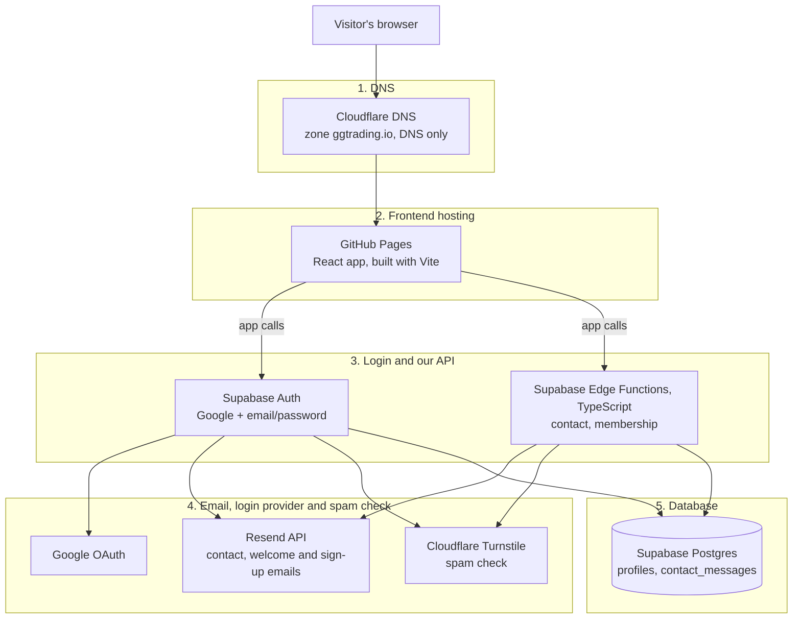

# ggtrading.io architecture

_Last updated: 29 Oct 2026. No keys or passwords here, only where they live._

React app on GitHub Pages that talks straight to its own Supabase project for sign-in, plans and the contact form.

## Tech stack

A visit goes top to bottom, one layer at a time.

| Layer | Technology | Hosted on | Used for |
|---|---|---|---|
| 1. DNS | Cloudflare DNS, not proxied | Cloudflare | Points ggtrading.io at GitHub Pages |
| 2. Frontend | React + Vite | GitHub Pages (`VFAssociates/ggtrading.io`) | Home page sections, Streams page, sign-in dialog |
| 3. Login | Supabase Auth | Supabase (project GG Trading, East US) | Member accounts: Google or email + password |
| 3. Our API | Supabase Edge Functions (TypeScript) | Supabase | Contact form and plan signup |
| 4. Email | Resend API, from noreply@ggtrading.io | Resend | Contact replies, admin notices, welcome and sign-up emails |
| 4. Spam check | Cloudflare Turnstile | Cloudflare | Contact form and email sign-in |
| 5. Database | Supabase Postgres | Supabase | Member profiles and contact messages |
| Mailboxes | Google Workspace | Google | brandon@ and contact@ggtrading.io |

**Adding our own APIs or database later** (Railway or similar): they would slot in at layer 3 and layer 5, next to or instead of the Supabase pieces.

Source code is in `VFTechLLC/ggtrading`; every push to main builds it into GitHub Pages.

## Site map

- **Home** `/`: one long page; the navbar scrolls to each section.
  - Hero
  - Features `#features`
  - Performance `#performance`
  - Pricing `#pricing`: Free, Pro, Elite → plan saved to the member's profile + welcome email
  - Community `#community`: links to YouTube and Kick
  - Leadership
  - Contact `#contact`: form → Edge Function → emails the visitor and admin@vftech.io
- **Streams** `/streams`: featured YouTube session plus a grid of past sessions
- **Join / Log in** (dialog): Google, or email + password with a Turnstile check
- **Page not found** `/404`

## What happens when…

**Someone sends the contact form**
1. If they're signed in, their email is filled in for them (they can change it).
2. They pass the Turnstile check and send.
3. The `contact` Edge Function verifies the check, limits repeats per hour and saves the message.
4. Resend sends "We got your message" to the visitor and the message to admin@vftech.io.

**Someone joins**
1. Join opens the sign-in dialog: Google, or email and password with a Turnstile check.
2. Email sign-ups get a confirmation email from Supabase, sent through Resend.
3. A profile row is created for the new member.

**A member picks a plan**
1. They choose Free, Pro or Elite in Pricing.
2. The `membership` Edge Function saves the plan on their profile.
3. The member gets a welcome email and admin@vftech.io gets a signup notice.
4. No payment is taken yet.

## Where to change things

| To change | Go to |
|---|---|
| Page text, design | `client/src/` in this repo. Every push to main goes live automatically. |
| Form and plan logic | `supabase/functions/`, deployed with `supabase functions deploy` |
| Settings and secrets | Supabase → GG Trading → Edge Functions → Secrets |
| Who gets contact emails | Edge Function secret `ADMIN_EMAIL` (default admin@vftech.io) |
| Sign-in emails | Supabase → Authentication → Emails → SMTP (Resend) |
| DNS | Cloudflare, account Admin@vftech.io, zone `ggtrading.io` |
| Sending email | Resend team `vftech`, domain ggtrading.io verified |
| Google sign-in | Google Cloud project `GG Trading`, plus the Google provider in Supabase Auth |
| Member data | Supabase tables `profiles` and `contact_messages` |

## Accounts and owners

| Service | Account |
|---|---|
| Source code | GitHub organization `VFTechLLC` |
| Live site repo | GitHub `VFAssociates` |
| DNS, Turnstile | Cloudflare, Admin@vftech.io's Account |
| Backend | Supabase organization `VF Tech`, project GG Trading |
| Outgoing email | Resend team `vftech` (admin@vftech.io) |
| Google sign-in | Google Cloud org `vftech.io`, project GG Trading |
| Company mailboxes | Google Workspace (brandon@, contact@) |

## Open items

- Site emails are plain text; the branded EmailJS design can be copied over.
